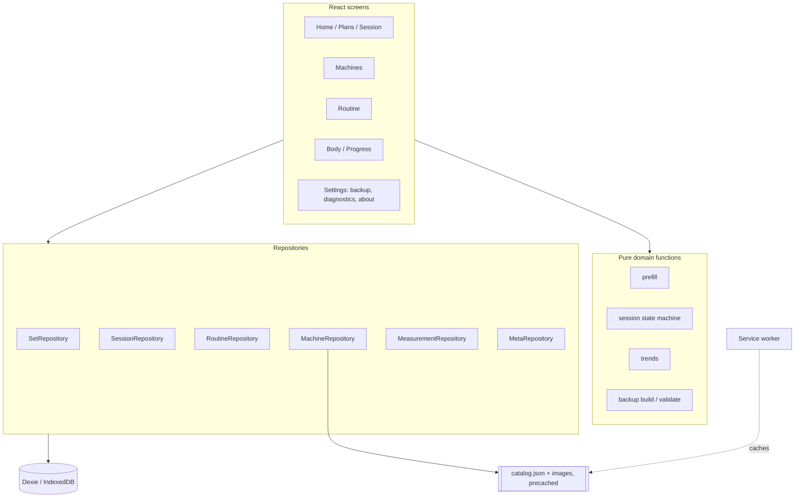

# Workout Tracker v1: machine-first set logging and body measurements

*   **Author:** mtmohamed.l
*   **Status:** Reviewed (implementation plan, 1 round; not re-reviewed after fixes)
*   **Date:** 2026-11-11

--------------------------------------------------------------------------------

## Overview

Workout Tracker is a website that is installed on a phone as a Progressive Web
App (PWA). During a gym session, the user logs reps and weight for each set. The
app also records body measurements. It covers only common gym machines from
Technogym, Life Fitness, Hammer Strength and Matrix Fitness, not free weights.
Machines guide the movement, which lowers the risk of injury from poor technique.

v1 has no server. Each device keeps its own data in the browser (IndexedDB). A
user moves data between devices with one JSON backup file: export it on the
phone, then import it on a PC, which replaces the PC copy. The app is a
TypeScript PWA served as static files from the Azure Static Web Apps Free plan
at its default `*.azurestaticapps.net` address. The first users are the author
and a few friends, each on their own phone. Nothing is shared between users.

Context: [concepts brief](../egm/concepts_brief.md).

## The Problem

The author and friends train mostly on machines and want to record every set
quickly between sets, often with weak or no signal in the gym. Existing apps
(Strong, Hevy, FitNotes) do this, but they charge a subscription for useful
features, and their workflow cannot be changed. The author wants a free app that
can be changed freely, starting with what they use every session: a planned
routine of machines, fast set entry, a rest timer, and body measurements over
time.

Building it as a local-only web app creates its own problem. The phone holds the
only copy of the data, and browsers can delete website data. Safari can remove
it after 7 days without use when the site is not installed, and any browser can
remove it when storage is low. On iPhone, a Safari tab and the installed app keep
separate data. The design must therefore treat data safety (install checks,
protected storage, backups, safe upgrades) as part of v1, not as a later
improvement.

**Proposed solution:** an offline-first PWA that saves every set to on-device
storage before showing it as saved, guides users to install it, asks the
browser to protect its storage, makes backup a single tap through the share
sheet, and upgrades its data format only in ways that add data.

## Goals

Measured over the first 4 weeks of use by the author and friends:

1.  **Daily use:** each user logs every gym session in the app for 4 weeks. The
    local usage summary (active days, sessions, sets) is the evidence.
2.  **Fast logging:** with the machine open in an active session, saving a set
    with unchanged pre-filled values takes 1 tap. Changing one value (reps or
    weight) and saving takes 3 taps or fewer.
3.  **Zero lost sets:** no set that the app showed as saved is later missing from
    device storage or from the next backup. A set counts as saved only after the
    IndexedDB write succeeds. The on-device event journal and consistency check
    are the evidence.
4.  **Works offline:** after the first load, every v1 feature works with no
    network, including after the app is closed and reopened.
5.  **Data survives updates:** no app update or data-format upgrade deletes or
    changes user records. An update never activates during an open session.
6.  **Data can be recovered:** a user can restore all their data on the same or
    another device from one backup file. The app tells the user when data looks
    cleared, and how many sets have not been backed up.
7.  **Machine-first catalog:** up to 30 built-in machines from the four brands,
    each with brand, model, muscle group, a short note on its purpose and a
    photo. Users can add their own machines and photos.
8.  **Body measurements:** body weight and circumferences (waist, hips, chest,
    neck, left and right arm, thigh and calf) with a simple trend line per
    site. Height is stored in the profile.
9.  **Any device:** the same site gives full read and write access on a phone
    (installed or in a browser tab, with a warning in the tab) and in a
    desktop browser, with a sporty, high-contrast look and tap
    targets of at least 48 px.
10. **Free to run:** hosting costs $0. An Azure budget with the smallest amount
    Azure accepts sends an alert if any cost appears.

## Non-Goals

*   Accounts, sign-in, a server database, and automatic sync between devices.
    These are the next stage.
*   Merging two devices' data. Import replaces all data on the target device.
    Keeping devices in step is the user's job.
*   CSV or any export format other than the JSON backup.
*   Automatic machine substitution. (Ready-made plans are in scope; see item 54.)
*   Body-shape analysis and an animated or 3D before/after body. Analytics stay
    simple: one trend line per measurement, plus the Progress screen (item 54).
*   Free-weight exercises.
*   Sharing, friends, leaderboards and any data shared between users.
*   Alerts while the phone is locked or the app is in the background. This
    would need push notifications from a server.
*   Languages other than English and right-to-left layout.
*   Native mobile apps and smartwatch support.
*   A custom domain. The `*.azurestaticapps.net` address stays for all of v1.
*   Paid hosting.

## Open Questions

*   **Server database for the sync stage:** Cosmos DB free tier or the Azure SQL
    free offer. This does not affect v1.

## Critical User Journeys (CUJs)

### CUJ 1: First run on a phone

*   **Given**: A user opens the site URL in Safari or Chrome on a phone for the
    first time.
*   **When**: The app loads in a browser tab.
*   **Then**: The app shows an install guide (steps for iOS, the install button
    on Android) with "Install" and "Continue in browser". Both lead to full
    use. In a phone browser tab, a warning banner stays on every screen: data
    in this tab is separate from the installed app and the browser may delete
    it, so install or back up often. After install or continue, onboarding
    explains that there is no account, that data stays on
    this device, and that regular backup is needed. It sets weight and length
    units and height, and requests protected storage. The result ("Storage
    protected: yes/no") is shown in Settings.

### CUJ 2: Log a set during a session

*   **Given**: The installed app, a saved routine, and no network.
*   **When**: The user opens today's session, taps Start, opens a machine and taps
    Save on the pre-filled set.
*   **Then**: The set is written to IndexedDB, and only after the write succeeds
    does the row show as saved and the rest timer start. An undo toast shows for
    5 seconds. Pre-fill comes from the previous set on this machine in this
    session, then the same set number in the last session on this machine, then
    the routine target, then empty.

### CUJ 3: App closed during rest

*   **Given**: An active session with the rest timer running.
*   **When**: The user locks the phone, or the OS closes the app, and the user
    opens it again 3 minutes later.
*   **Then**: The app reopens the same session. The timer is recalculated from
    the stored end time and shows the actual rest taken. No set is missing.

### CUJ 4: Back up after a session

*   **Given**: An active session with sets that have not been backed up.
*   **When**: The user taps Finish.
*   **Then**: The finish screen shows "N sets not backed up" and a Back up
    button. It opens the share sheet with the JSON backup file, which the user
    saves to iCloud, OneDrive or a chat. "Last backup" updates only after the
    share completes; otherwise it shows "backup started".

### CUJ 5: Review on a PC

*   **Given**: A backup file on the PC and the site open in a desktop browser.
*   **When**: The user chooses Import and picks the file.
*   **Then**: The app checks the file, shows its counts per record type, and
    warns if this PC has changes that have not been exported. On confirmation
    it first downloads a backup of the PC's current data, then replaces all
    data in one transaction. Dashboards and trends show the phone's data.

### CUJ 6: App update

*   **Given**: A new version is deployed, and the user has the app open.
*   **When**: The service worker finds the new version.
*   **Then**: If no session is open, an "Update available" banner offers
    reload. If a session is open, the banner waits until the session finishes.
    If the new version raises the database version, the app saves a local
    snapshot first, then upgrades by adding fields only.

### CUJ 7: Data cleared by the browser

*   **Given**: The browser has deleted the app's IndexedDB data.
*   **When**: The user opens the app.
*   **Then**: Instead of an empty app, it shows "Your data appears to have been
    cleared" with a Restore from backup button, if the local marker survived.
    If no marker survived, first run asks "Used this app before?" and offers
    restore.

### CUJ 8: Record body measurements

*   **Given**: The installed app.
*   **When**: The user opens Body, enters weight and waist, and saves.
*   **Then**: Each value is stored as one row in kg or cm. The trend line for a
    site appears once it has 2 or more points. Other sites are shown on demand,
    each with a "how to measure" hint.

## Technical Plan (Architecture)

### Stack

| Area | Choice | Reason |
| --- | --- | --- |
| Language | TypeScript (strict) | Author choice. |
| UI | React 19 | Author choice. |
| Build | Vite | Author choice (brief). |
| Offline and install | `vite-plugin-pwa` (Workbox) | Author choice (brief). |
| Storage | Dexie 4 over IndexedDB, with `dexie-react-hooks` | Author choice (brief). `useLiveQuery` redraws screens when stored data changes. |
| Routing | React Router (browser routes) | Mechanical. SWA falls back to `index.html`. |
| Styling | Tailwind CSS | Author choice. |
| Headings font | Oswald (SIL Open Font License), bundled as WOFF2 and precached; system fonts for body text | Author choice. |
| Muscle-group icons | 6 custom SVGs drawn for this app (chest, back, shoulders, arms, legs, core) | Author choice. |
| Machine catalog | 30 machines listed in [catalog proposal](../egm/catalog_proposal.md) | Author accepted the proposal. |
| Charts | Recharts | Author choice. Loaded only on the Body and Progress screens (lazy routes). |
| Anatomical body maps | `react-muscle-highlighter` (MIT), front and back male figures | Author choice in the UX review (P5b). Used for muscle balance, machine pages and the measuring guide. |
| People photos | Royalty-free photos stored in `public/images/people/`, credited in Settings | Author choice in the UX review: real people, modest clothing. |
| Tests | Vitest + `fake-indexeddb`, Playwright | Mechanical. |
| Hosting | Azure Static Web Apps Free, deployed by GitHub Actions from a private repository | Author choice (brief). |

### Layers

Screens never call Dexie directly. They call repositories, which hide the
storage engine. The later sync stage adds an adapter behind the same
interfaces. Business rules (pre-fill, trends, backup validation, session state)
are pure functions with no React or Dexie imports, so they can be unit tested.



### Data model

Every user record has `id` (UUID from `crypto.randomUUID()`), `createdAt`,
`updatedAt`, `deletedAt` (null unless deleted) and `deviceId`. Deletes set
`deletedAt` and do not remove rows. Weights are stored in kg and lengths in cm;
the profile picks the display units. These fields are not needed by
replace-all import, but they allow merge and sync later without a data
migration.

| Table | Key fields | Notes |
| --- | --- | --- |
| `profile` | `id='me'`, `heightCm`, `weightUnit` (kg/lb), `lengthUnit` (cm/in), `defaultRestSec` (90), `checkInDay?` (0–6, Sunday = 0), `deviceId` | One row. `checkInDay` is the weekly measuring day; absent means off. |
| `machines` | `id`, `name`, `muscleGroup`, `weightStepKg`, `restSec?`, `photoId?`, `aliases[]` | Custom machines only. `id` is `custom-<uuid>`. |
| `machineSettings` | `machineId`, `photoId?`, `weightStepKg?`, `restSec?`, `hidden` | User overrides for built-in machines. |
| `photos` | `id`, `blob` (≤50 KB after resize), `mime` (`image/webp`, or `image/jpeg` where WebP encoding is unavailable) | User photos. |
| `routines` | `id`, `name`, `items[]: {machineId, targetSets, targetReps, targetWeightKg?, scheme?}` | One routine in v1 (`id='main'`). The table allows several routines later without a migration. `scheme` is the set style (item 54); absent means straight sets. |
| `plans` | `id` (`my-<uuid>`), `name`, `tagline`, `description`, `goal`, `level`, `daysPerWeek`, `minutes`, `days[]: {name, items[]}` | The user's own plans (schema version 2, item 55). |
| `sessions` | `id`, `routineId?`, `state`, `machineOrder[]`, `startedAt?`, `finishedAt?`, `currentMachineId?`, `restStartedAt?`, `restEndsAt?` | At most one open session (`notStarted`, `active` or `resting`). |
| `sets` | `id`, `sessionId`, `machineId`, `setNumber`, `reps`, `weightKg`, `loggedAt`, `restBeforeSec?` | Indexed by `[machineId+loggedAt]` and `sessionId`. |
| `measurements` | `id`, `site`, `side?` (left/right), `value`, `takenAt` | Value in kg (weight) or cm. |
| `journal` | `seq` (auto), `at`, `type` (set.created/updated/deleted/restored), `entityId`, `sessionId` | Append-only, for the consistency check. |
| `errors` | `seq`, `at`, `kind`, `message`, `stack?` | Keeps the latest 500. No set or measurement values. |
| `meta` | `key`, `value` | `deviceId` (this device), `lastExportAt`, `lastExportState`, `schemaVersion`, `installedAt`. |

The built-in catalog is not stored in IndexedDB. It is a versioned file,
`catalog.json`, precached with its images. Each machine has a permanent slug ID
(for example `technogym-selection-900-chest-press`; rule in item 16), `brand`,
`line`, `model`, `muscleGroup`, `secondaryMuscles[]`, `note`, `weightStepKg`,
`defaultRestSec`, `image` and `imageSourceUrl`. `image` is a path to a photo file copied into the app
(`public/images/machines/<slug>.webp`) and served from our own origin. The app
never loads images from brand websites, so their CORS or hotlink rules cannot
break it. `imageSourceUrl` is text only, kept for attribution and takedown.
Slugs are never reused. Retired machines stay in the file with
`retired: true` and are hidden from lists, so old sets still show a name. A set
that refers to an unknown machine ID shows as "Unknown machine" and is kept.

### Session state machine

States: `notStarted`, `active`, `resting`, `finished`. Opening today's session
from the Home screen creates it in `notStarted` with a copy of the routine's
machine list (`machineOrder`). In this state the user can skip, move up or down, or add
machines, or Discard (soft delete). Start sets `startedAt` and moves to
`active`. Sets can be saved only in `active` or `resting`. Saving a set moves to
`resting` and sets `restEndsAt`. Rest ends when the
timer reaches zero, or when the user taps Skip or saves the next set; then the
state returns to `active` and `restBeforeSec` on the next set records the actual
rest. Finish moves to `finished`. State is saved on every change, so a reload
restores it. A session left open (any state except `finished`) for more than
12 hours is shown as "unfinished" with Resume or Finish (Discard for
`notStarted`). Its date is its `startedAt` date, so sessions past midnight are
not split.

### Rest timer

Remaining time is `restEndsAt − now`, recalculated every second while visible
and on `visibilitychange`. Buttons: −15 s, +15 s, Skip. A "keep screen on"
toggle uses the Screen Wake Lock API where available and asks again after the
app becomes visible. There is no alert while locked or in the background.

### Saving sets (zero-loss path)

1.  The user taps Save.
2.  `SetRepository.add` writes the set, its journal row and the session's
    rest fields in one Dexie transaction.
3.  Only after the transaction resolves does the screen show the set as saved
    and start rest. The list reads from storage through `useLiveQuery`, not
    from in-memory state.
4.  If the write fails, the row stays in edit mode with a "Not saved, try
    again" message, and the error goes to the error log.

On launch and on demand in Diagnostics, a consistency check compares the
journal with the `sets` table and reports any set the journal created that is
missing.

### Data safety on the device

*   **Browser-tab warning (author decision, against brief Requirement 9):**
    every device has full read and write access. On a touch device not
    running as installed (`display-mode: standalone` is false), nothing is
    blocked; a persistent warning banner (`TabWarningBanner`) says the tab's
    data is separate from the installed app and may be deleted by the
    browser, with Install and Back up actions. Accepted risk: on iPhone,
    history can be split between the tab and the installed app, and tab data
    can be deleted after 7 days without use. Desktop browsers show no banner.
*   **Protected storage:** call `navigator.storage.persist()` after onboarding
    and show the result and `navigator.storage.estimate()` in Settings.
*   **Cleared-data detection:** a marker with the last known counts is written
    to `localStorage` at the end of onboarding, on every launch after the
    database opens with data, and after an import (rules in item 39). On
    launch, if the marker exists but IndexedDB is empty or the counts have
    dropped, CUJ 7 runs.
*   **Backup reminders:** Settings and the session finish screen show sets
    changed since the last backup. A banner appears when that number is 1 or
    more and the last backup is more than 7 days old.

### Backup file (format version 2)

Version 2 adds `data.plans` (item 55). Version 1 files still import.

```json
{
  "format": "workout-tracker-backup",
  "formatVersion": 2,
  "schemaVersion": 2,
  "appBuild": "<git sha>",
  "exportedAt": "2026-11-11T16:00:00Z",
  "deviceId": "<uuid>",
  "manifest": { "counts": { "sets": 120, "sessions": 9, "...": 0 }, "sha256": "<of data and photos>" },
  "data": { "profile": {}, "machines": [], "machineSettings": [], "routines": [],
            "plans": [], "sessions": [], "sets": [], "measurements": [] },
  "photos": [ { "id": "<uuid>", "mime": "image/webp", "base64": "..." } ]
}
```

*   **Export:** builds the file, then uses `navigator.share({ files })` where
    `navigator.canShare` allows it, otherwise downloads it. The file is named
    `workout-backup-YYYY-MM-DD-HHmm.json`. The journal and error log are not
    included.
*   **Import (replace-all):** parse, check `format`, reject a `formatVersion`
    higher than supported ("made by a newer app version; update first"), and
    upgrade older versions step by step. Check the SHA-256 and the counts, and
    validate every record. Show the counts and warn if this device has changes
    since its last export. On confirmation, export the current data
    automatically; if that export fails or is cancelled, the import stops.
    Then clear and write all tables in one Dexie transaction.
    If any step fails, nothing changes.

### Updates and schema upgrades

*   `vite-plugin-pwa` with `registerType: 'prompt'`. The app shows the update
    banner only when no session is open, and reloads only when the user taps it.
*   Dexie `version(n)` numbers only increase. An upgrade may add tables,
    indexes or fields with defaults, and never deletes or renames data.
*   Before opening a newer version, the app reads the stored version. If it is
    older, it saves a snapshot of all tables to the `snapshots` store of a
    separate database (`workout-tracker-snapshots`), keeping the last 2.
*   On `versionchange` (another tab upgrading) the app closes its database and
    asks the user to reload. On `blocked` it asks the user to close other tabs.
*   If the database fails to open (including `VersionError` after a rollback),
    the app shows a recovery screen with "Export raw data" and "Report
    problem". It never deletes data automatically. Fixes are new releases;
    there is no rollback of the data format.

### Hosting and caching

`staticwebapp.config.json` sets `navigationFallback` to `/index.html` (excluding
`/assets/*`, `/catalog/*` and `/images/*`), `Cache-Control: no-cache` for
`/index.html`, `/sw.js` and `/manifest.webmanifest`, and long-lived caching for
hashed files under `/assets/`. It also sets a Content-Security-Policy that
allows only same-origin scripts, fonts and images (plus `blob:`/`data:`
images), and same-origin styles plus inline style attributes, which Recharts
needs. The
site has no API, no cookies and no third-party requests.

### Diagnostics and About

*   About shows app build (git SHA), schema version, backup format version and
    catalog version.
*   "Export diagnostics" shares a JSON file with: the above versions, user
    agent, installed yes/no, storage protected yes/no, storage estimate, record
    counts, consistency check result, and the error log. It contains no set,
    measurement or profile values.
*   Global `error` and `unhandledrejection` handlers and Dexie error paths
    write to the error log.

### Screens

| Route | Screen |
| --- | --- |
| `/` | Home dashboard: hero with today's session or Resume, weekly stats (workouts, sets, volume, week streak), Next up machines, Body card with weekly check-in status, muscle balance body map, recent workouts. |
| `/plans`, `/plans/:id` | Ready-made plans library with Goal and Focus filters, plus my own plans (item 55) and Create, Import and Download template; plan detail with days, set styles, Start now and Use as my routine (Edit and Delete for my own plans). |
| `/plans/new`, `/plans/:id/edit` | Plan editor for my own plans (item 55). | 
| `/session` | Active session: machine list in routine order (skip, move up or down), set logging with set-style hints, rest timer. |
| `/machines`, `/machines/:id` | Search and muscle-group filter chips, machine detail with "Muscles worked" body map, history, photo replace. |
| `/machines/new`, `/machines/:id/edit` | Custom machine form (`MachineFormScreen`); edit also changes settings of a built-in machine. |
| `/routine` | Routine editor (the single v1 routine), including set style per machine. |
| `/progress` | Muscle balance (sets per muscle, last 7 days), weekly routine activity and streak, strength trend per machine. |
| `/body` | Latest values, weekly check-in day, measurement entry with animated measuring guide, trend lines, history. |
| `/settings` | Appearance (system, light, dark), units, height, default rest, backup and restore, storage status, diagnostics, image and photo sources, about. |
| `/welcome` | Install guide, "Used this app before?", and onboarding (steps are internal state of `WelcomeScreen`, not separate routes). |

The layout is one column on phones and two columns on wide screens, with a dark
theme by default and a light theme (item 54), a high-contrast accent colour,
tap targets of 48 px or more, and no swipe-only actions. All user-facing text
lives in one strings module. Dates and numbers use `Intl`. The approved visual
design is described in item 54.

## Alternatives Considered

### Alternative A: Use an existing app (Strong, Hevy, FitNotes, JEFIT)

*   **Pros**: Available today, tested by many users, with sync and charts.
*   **Cons**: Useful features need a subscription. The workflow and catalog
    cannot be changed. Not machine-first.
*   **Reason for Rejection**: Rejected by author: subscription cost and no
    freedom to customize the workflow.

### Alternative B: Server with accounts and sync in v1

*   **Pros**: Data survives phone loss and browser clean-up. Multiple devices
    stay in step without files.
*   **Cons**: Adds sign-in, an API, a database, conflict handling, token expiry
    and free-tier limits (CPU caps, pausing, cold starts) to v1. Logging must
    still work offline, so the phone remains the first copy anyway.
*   **Reason for Rejection**: Rejected by author after the first review: v1 is
    local-only with file backup. Server sync is the next stage. The data model
    keeps IDs, timestamps and delete markers so that stage needs no migration.

### Alternative C: Always-online website (server as the source of truth)

*   **Pros**: One copy of the data, no storage eviction risk on the phone.
*   **Cons**: Logging fails with weak gym signal, which breaks "zero lost sets".
*   **Reason for Rejection**: Rejected by author: logging must not depend on the
    network.

### Alternative D: Merge import instead of replace-all

*   **Pros**: Combines data entered on two devices.
*   **Cons**: Needs conflict rules (newest edit wins), delete markers that must
    survive import, and idempotence tests. Most of this work is repeated later
    by sync.
*   **Reason for Rejection**: Rejected by author: data is entered on the phone
    and reviewed on the PC, so replace-all is enough. The user is responsible
    for re-syncing after editing on another device.

### Alternative E: CSV export

*   **Pros**: Opens in Excel.
*   **Cons**: Another format to version and test, with formula-injection
    escaping. Cannot be imported back.
*   **Reason for Rejection**: Rejected by author: the PC opens the same website
    and imports the JSON backup.

### Alternative F: Blazor WebAssembly frontend

*   **Pros**: Matches the author's preference for the Microsoft stack. C#
    throughout.
*   **Cons**: 2–5 MB first download. IndexedDB, wake lock and the share sheet
    are reached through JavaScript interop.
*   **Reason for Rejection**: Rejected by author: a TypeScript PWA is smaller
    and uses the browser features directly.

### Alternative G: Other UI frameworks (Svelte 5, Vue 3)

*   **Pros**: Svelte produces the smallest bundles with no runtime library. Vue
    has a medium bundle and HTML-like templates.
*   **Cons**: Smaller ecosystems than React for charts, examples and help.
*   **Reason for Rejection**: Rejected by author: React chosen for its
    ecosystem, at the cost of about 45 KB extra download.

### Alternative H: Other chart libraries (Chart.js, uPlot)

*   **Pros**: Chart.js is smaller (about 65 KB) with built-in animation. uPlot
    is about 15 KB and very fast.
*   **Cons**: Chart.js is configured with objects rather than React components
    and draws on a canvas. uPlot looks plain and needs the most styling work.
*   **Reason for Rejection**: Rejected by author: Recharts chosen for writing
    charts as React components. Its larger size (about 95 KB) is limited by
    loading it only on the Body screen.

### Alternative I: Other styling (CSS Modules, MUI)

*   **Pros**: CSS Modules have no dependency. MUI has ready-made accessible
    components (dialogs, snackbars, sliders).
*   **Cons**: CSS Modules mean writing every style by hand. MUI is large (about
    90 KB or more) and looks like Material Design unless heavily themed.
*   **Reason for Rejection**: Rejected by author: Tailwind CSS chosen for a
    custom look with little unused CSS.

### Alternative J: Other free hosts (MonsterASP.NET, GitHub Pages)

*   **Pros**: MonsterASP.NET supports .NET. GitHub Pages is simple static
    hosting.
*   **Cons**: The MonsterASP.NET free plan has no HTTPS (checked 2026-11-11), and
    service workers need HTTPS. GitHub Pages needs a public repository on a free
    account, which would publish the copied brand photos, and has no backend for
    the next stage.
*   **Reason for Rejection**: Rejected by author: Azure Static Web Apps Free
    gives HTTPS, a private repository and a path to Azure Functions later.

### Alternative K: Link to brand pages instead of copying photos

*   **Pros**: No copyright risk; linking is not copying.
*   **Cons**: Needs network to view, and leaves the app; brand pages change.
*   **Reason for Rejection**: Rejected by author, who accepted the copyright risk.
    Mitigations: private repository, a source URL per image, no logos, and
    removal on request.

--------------------------------------------------------------------------------

## Detailed Implementation Plan

The repository has no application code today. The app lives at the repository
root. Node 22 LTS and npm are used. Every file below is new unless marked
Modify.

### Phases

Build in this order. A phase starts only when the previous phase's exit
command passes locally and in CI.

| Phase | Items | Exit command |
| --- | --- | --- |
| P1 Scaffold, lint and CI | 1-9, 21-23, 47, 53 (CI jobs only, no deploy step yet) | `npm run lint && npm test && npm run build` |
| P2 Storage, domain and repositories | 24-37, 48-50 | `npm run test:coverage` |
| P3 Platform helpers | 38-44, 51 | `npm run lint && npm test` |
| P4 Catalog, assets and scripts | 10-18, Manual setup 4-5 | `npm run catalog:check && npm run build` |
| P5 Components and screens | 19-20, 45-46 | `npm run lint && npm test && npm run build` |
| P5b UX redesign (approved in review with the author) | 54 | `npm run lint && npm test && npm run build && npm run catalog:check` |
| P6 End-to-end tests and deploy | 52 (covering the P5b screens too), 53 (deploy and preview jobs), Manual setup 1-3 | `npm run e2e`, then a green PR preview and production smoke step |
| P7 Custom plans, import and template | 55 | `npm run lint && npm test && npm run build && npm run e2e` |

### Target Files to Create/Modify

#### Project and build configuration

##### 1. `./package.json` (Create)

*   **Type / Scope**: npm manifest.
*   **Proposed Changes**: Major versions are pinned with `^`; check each with
    `npm view <pkg> version` at scaffold time and keep the major below unless
    it has moved on. Dependencies: `react@^19`, `react-dom@^19`,
    `react-router@^7`, `dexie@^4`, `dexie-react-hooks@^4`, `recharts@^3`.
    Dev dependencies: `typescript@^5`, `@types/react@^19`,
    `@types/react-dom@^19`, `@types/node@^22`, `vite@^7`,
    `@vitejs/plugin-react@^5`, `vite-plugin-pwa@^1`, `workbox-window@^7`,
    `tailwindcss@^4`, `@tailwindcss/vite@^4`, `vitest@^4`,
    `@vitest/coverage-v8@^4`, `fake-indexeddb@^6`, `@testing-library/react@^16`,
    `@testing-library/dom@^10`, `jsdom@^26`, `@playwright/test@^1`,
    `eslint@^9` (flat config), `@eslint/js@^9`, `globals@^16`,
    `typescript-eslint@^8`, `eslint-plugin-react-hooks@^5`, `sharp@^0.34`
    (image script only). Scripts:
    *   `dev`: `vite`
    *   `build`: `tsc -b && vite build`
    *   `preview`: `vite preview --port 4173`
    *   `test`: `vitest run`
    *   `test:coverage`: `vitest run --coverage`
    *   `e2e`: `playwright test`
    *   `lint`: `eslint . && tsc -b --noEmit`
    *   `catalog:check`: `node scripts/check-catalog.mjs`
    *   `images:prepare`: `node scripts/prepare-images.mjs`

    `package-lock.json` is generated by `npm install` and committed.

##### 2. `./.nvmrc` (Create)

*   **Type / Scope**: Tool version.
*   **Proposed Changes**: `22`. CI and local builds use the same Node major.

##### 3. `./tsconfig.json`, `./tsconfig.app.json`, `./tsconfig.node.json`, `./src/vite-env.d.ts` (Create)

*   **Type / Scope**: TypeScript configuration.
*   **Proposed Changes**:
    *   `tsconfig.json`: `files: []`, `references` to `tsconfig.app.json` and
        `tsconfig.node.json`.
    *   Both: `strict: true`, `noUncheckedIndexedAccess: true`, `target:
        "ES2022"`, `module: "ESNext"`, `moduleResolution: "bundler"`,
        `composite: true`, `skipLibCheck: true`.
    *   `tsconfig.app.json`: `include: ["src"]`, `lib: ["ES2022", "DOM",
        "DOM.Iterable"]`, `jsx: "react-jsx"`, `types: ["vite/client",
        "vite-plugin-pwa/react"]`.
    *   `tsconfig.node.json`: `include: ["vite.config.ts",
        "playwright.config.ts", "eslint.config.js", "scripts", "e2e"]`,
        `lib: ["ES2022"]`, `types: ["node"]`.
    *   `src/vite-env.d.ts`: `/// <reference types="vite/client" />`,
        `/// <reference types="vite-plugin-pwa/react" />`, and
        `declare const __APP_BUILD__: string; declare const __BUILD_TIME__:
        string;`.

    App and Node code are split so browser code cannot import Node modules.

##### 4. `./vite.config.ts` (Create)

*   **Type / Scope**: Build, PWA and unit-test configuration.
*   **Proposed Changes**:
    *   Plugins: React, `@tailwindcss/vite`, `VitePWA`.
    *   `VitePWA`: `registerType: 'prompt'`, `injectRegister: false` (the app
        registers through `src/platform/updates.ts`), manifest (name "Workout
        Tracker", short name "Workout", `display: 'standalone'`,
        `orientation: 'portrait'`, dark `theme_color` and
        `background_color`, icons 192, 512 and 512 maskable), Workbox
        `globPatterns` covering JS, CSS, HTML, `catalog/*.json`,
        `images/**/*.{webp,svg}`, `fonts/*.woff2` and icons, and
        `navigateFallback: '/index.html'`. The catalog is precached, so the
        app reads it from the cache first; a new catalog arrives only with a
        new service worker version.
    *   `define`: `__APP_BUILD__` from `APP_BUILD`, else `GITHUB_SHA`, else
        `dev`, and
        `__BUILD_TIME__`.
    *   `test`: environment `jsdom`, setup file `src/test/setup.ts`,
        `include: ["src/**/*.test.{ts,tsx}", "scripts/**/*.test.mjs"]`,
        coverage provider `v8` with:

        ```ts
        thresholds: {
          'src/domain/**': { lines: 90, branches: 85 },
          'src/data/**': { lines: 80 },
          'src/db/**': { lines: 80 },
        }
        ```

##### 5. `./eslint.config.js` (Create)

*   **Type / Scope**: Lint rules.
*   **Proposed Changes**: `@eslint/js` recommended, `typescript-eslint`
    recommended and React hooks rules, browser `globals` for `src/` and Node
    `globals` for `scripts/` and config files. One project rule
    (`no-restricted-imports`) for files under `src/screens` and
    `src/components`: `paths: ['dexie']` and `patterns: ['**/db', '**/db/*']`,
    so both alias and relative imports of the database are rejected. This
    enforces the repository layer.

##### 6. `./playwright.config.ts` (Create)

*   **Type / Scope**: End-to-end test configuration.
*   **Proposed Changes**: `testDir: 'e2e'`, `baseURL:
    'http://localhost:4173'`, and `webServer: { command: 'npm run build &&
    npm run preview', port: 4173, reuseExistingServer: !process.env.CI }`.
    `update.spec.ts` starts its own servers (item 52). Projects: "Mobile
    Chrome" (Pixel 7), "Mobile Safari" (iPhone 14 device profile on WebKit)
    and "Desktop Chrome" for the PC review journey. Playwright WebKit with an
    iPhone profile is not iOS Safari: iOS install, storage eviction and share
    sheet behaviour are checked only in the manual step of the Verification
    Plan.

##### 7. `./index.html` (Create)

*   **Type / Scope**: App shell.
*   **Proposed Changes**: Root element, viewport meta with
    `viewport-fit=cover`, `apple-mobile-web-app-capable`,
    `apple-touch-icon`, theme colour, and
    `<meta name="robots" content="noindex, nofollow">`, which asks search
    engines not to index the site or the copied brand photos. It does not
    stop anyone who has the address from opening it.

##### 8. `./.gitignore` (Create)

*   **Type / Scope**: Git ignore rules.
*   **Proposed Changes**: `node_modules/`, `dist/`, `coverage/`,
    `test-results/`, `playwright-report/`, `scripts/source-images/`.

##### 9. `./README.md` (Modify)

*   **Type / Scope**: Documentation.
*   **Proposed Changes**: Add how to run (`npm ci`, `npm run dev`, `npm test`,
    `npm run e2e`), how to deploy, where data lives, the backup and restore
    steps for users, the fixed-address rule (never delete the Azure resource),
    and the brand-photo policy (private repository, source URL per image, no
    logos, remove on request). Link the design document.

#### Static assets and hosting

##### 10. `./public/staticwebapp.config.json` (Create)

*   **Type / Scope**: Azure Static Web Apps configuration.
*   **Proposed Changes**: `navigationFallback` to `/index.html`, excluding
    `/assets/*`, `/catalog/*`, `/images/*`, `/fonts/*`, `/icons/*`.
    `routes` headers: `Cache-Control: no-cache` for `/index.html`, `/sw.js`,
    `/manifest.webmanifest`, `/catalog/*`; `public, max-age=31536000,
    immutable` for `/assets/*`. `globalHeaders`: Content-Security-Policy
    `default-src 'self'; img-src 'self' blob: data:; style-src 'self'
    'unsafe-inline'; font-src 'self'; connect-src 'self'; object-src
    'none'; base-uri 'self'; frame-ancestors 'none'` (`'unsafe-inline'` in
    `style-src` is needed for Recharts' inline style attributes; scripts stay
    same-origin only), `X-Content-Type-Options: nosniff`, `Referrer-Policy:
    no-referrer`, and `X-Robots-Tag: noindex, nofollow`.

##### 11. `./public/robots.txt` (Create)

*   **Type / Scope**: Crawler rules.
*   **Proposed Changes**: `User-agent: *` with an empty `Disallow:` line. It
    does not block crawling on purpose: a crawler must be able to fetch pages
    to see the `noindex` meta tag and `X-Robots-Tag` header, which are what
    keep the site out of search results.

##### 12. `./public/icons/` (Create)

*   **Type / Scope**: App icons.
*   **Proposed Changes**: `icon-192.png`, `icon-512.png`,
    `icon-512-maskable.png`, `apple-touch-icon-180.png`. Original artwork, no
    brand logos.

##### 13. `./public/fonts/oswald-variable.woff2` and `./public/fonts/OFL.txt` (Create)

*   **Type / Scope**: Font and licence.
*   **Proposed Changes**: Oswald variable font, Latin subset only, with the SIL
    Open Font License text required for redistribution.

##### 14. `./public/images/muscles/{chest,back,shoulders,arms,legs,core}.svg` (Create)

*   **Type / Scope**: Fallback images.
*   **Proposed Changes**: Six single-colour SVGs drawn for this app, coloured
    through `currentColor` so the theme sets the colour.

##### 15. `./public/images/machines/<slug>.webp` (Create, 30 files)

*   **Type / Scope**: Catalog photos.
*   **Proposed Changes**: One photo per catalog machine, produced by
    `scripts/prepare-images.mjs`: longest side 640 px, WebP, 50 KB or less,
    with metadata removed. Logos visible in a photo are cropped out. If a
    photo is not available, the catalog entry has `image: null` and the
    muscle-group icon is shown.

##### 16. `./public/catalog/catalog.json` (Create)

*   **Type / Scope**: Versioned catalog data.
*   **Proposed Changes**: Shape:

    ```json
    {
      "catalogVersion": 1,
      "muscleGroups": ["chest", "back", "shoulders", "arms", "legs", "core"],
      "machines": [{
        "id": "technogym-selection-900-chest-press",
        "brand": "Technogym", "line": "Selection 900", "model": "Chest Press",
        "muscleGroup": "chest", "secondaryMuscles": ["front delts", "triceps"],
        "note": "Pressing on a fixed path builds the chest without balancing a bar.",
        "weightStepKg": 5, "defaultRestSec": null,
        "image": "images/machines/technogym-selection-900-chest-press.webp",
        "imageSourceUrl": "https://www.technogym.com/...",
        "aliases": ["chest press"], "retired": false
      }]
    }
    ```

    The 30 entries follow [catalog proposal](../egm/catalog_proposal.md).
    `line` is a new field (the brand's product line). IDs never change and
    are built by one rule: `slug(brand) + "-" + slug(line) + "-" +
    slug(machine)`, where `slug` lower-cases the text, removes any
    bracketed model code such as `(VS-S13)`, replaces every run of
    characters other than `a-z` and `0-9` (spaces, "/", "-") with one `-`,
    and trims `-` from both ends. Examples:
    `technogym-selection-900-chest-press`,
    `life-fitness-insignia-pectoral-fly-rear-deltoid`,
    `matrix-versa-converging-chest-press`. `defaultRestSec` is the catalog's
    rest suggestion (`null` uses the profile default); a user's own value is
    `machineSettings.restSec` (item 32 gives the order).

#### Scripts

##### 17. `./scripts/prepare-images.mjs` (Create)

*   **Type / Scope**: Node script, run by hand.
*   **Proposed Changes**: Reads originals from `scripts/source-images/` (not
    committed), resizes and converts them with `sharp`, lowers WebP quality
    until each file is 50 KB or less, and writes to `public/images/machines/`.

##### 18. `./scripts/check-catalog.mjs` (Create)

*   **Type / Scope**: Node script, run in CI.
*   **Proposed Changes**: Fails if: an ID is duplicated or does not match the
    slug rule in item 16 for its brand, line and machine; a muscle group is
    unknown; an `image` file is missing or over 50 KB; a non-null `image` has
    no `imageSourceUrl`; there are more than 30 non-retired machines; or an ID
    in the base catalog is missing instead of marked `retired`. `image: null`
    is allowed and needs no `imageSourceUrl`. The base catalog is read with
    `git show origin/${BASE_REF}:public/catalog/catalog.json`, where
    `BASE_REF` is `GITHUB_BASE_REF` on pull requests and `master` otherwise
    (on a push to `master`, compare with `HEAD~1` instead). The CI checkout
    uses `fetch-depth: 0` so these refs exist. If the base file does not
    exist (first catalog), the removed-ID check is skipped.

#### Application entry, styling and text

##### 19. `./src/main.tsx` (Create)

*   **Type / Scope**: Entry point.
*   **Proposed Changes**: Installs the error log handlers
    (`platform/errorLog.ts`) first, opens the database through
    `db/open.ts`, then renders by the first matching rule:
    1.  `failed` -> `RecoveryScreen`.
    2.  `cleared` -> `DataClearedScreen`.
    3.  Otherwise `<App/>`, which applies the routing rules in item 20.

##### 20. `./src/App.tsx` (Create)

*   **Type / Scope**: Router and layout.
*   **Proposed Changes**: Routes from the Screens table. On launch, the first
    matching rule applies:
    1.  No profile -> `/welcome` (install guide on touch devices not running
        installed, with "Continue in browser"; then "Used this app before?";
        then onboarding).
    2.  Otherwise the requested route, or `/` if none.

    Nothing is blocked after onboarding. Mounts `UpdateBanner`,
    `BackupBanner` and, on touch devices not running installed,
    `TabWarningBanner`. Lazy-loads `BodyScreen` so Recharts is downloaded
    only there.

##### 21. `./src/index.css` (Create)

*   **Type / Scope**: Tailwind entry and theme.
*   **Proposed Changes**: `@import "tailwindcss"`, an `@theme` block with the
    colour tokens (dark background, one high-contrast accent, success, danger),
    `--font-display: "Oswald"` and the system font stack for body text, and an
    `@font-face` for Oswald with `font-display: swap`. Minimum tap size
    utility of 48 px.

##### 22. `./src/strings.ts` and `./src/format.ts` (Create)

*   **Type / Scope**: User-facing text and formatting.
*   **Proposed Changes**: `strings.ts` exports one object with every
    user-facing string, including the install steps and the "how to measure"
    hint per site. `format.ts` wraps `Intl.NumberFormat` and
    `Intl.DateTimeFormat` and converts display units (kg/lb, cm/in). Weights
    in lb are shown rounded to 0.5 lb; lengths in inches to 0.1 in.

##### 23. `./src/buildInfo.ts` (Create)

*   **Type / Scope**: Version constants.
*   **Proposed Changes**: Exports `APP_BUILD`, `BUILD_TIME`,
    `SCHEMA_VERSION = 1`, `BACKUP_FORMAT_VERSION = 1`.

#### Storage

##### 24. `./src/db/types.ts` (Create)

*   **Type / Scope**: Record types.
*   **Proposed Changes**: All times are ISO 8601 UTC strings (`Iso`). Weights
    are always kg and lengths always cm; the field name says so where the
    table holds one kind of value, and `Measurement.value` uses the unit
    implied by `site`.

    ```ts
    export type Iso = string;
    export interface BaseRecord {
      id: string; createdAt: Iso; updatedAt: Iso;
      deletedAt: Iso | null; deviceId: string;
    }
    export type MuscleGroup = 'chest' | 'back' | 'shoulders' | 'arms' | 'legs' | 'core';
    export interface Profile extends BaseRecord {
      id: 'me'; heightCm: number | null; weightUnit: 'kg' | 'lb';
      lengthUnit: 'cm' | 'in'; defaultRestSec: number;
    }
    export interface CustomMachine extends BaseRecord {
      name: string; muscleGroup: MuscleGroup; weightStepKg: number;
      restSec?: number; photoId?: string; aliases: string[];
    }
    export interface MachineSettings {           // key: machineId
      machineId: string; updatedAt: Iso; deviceId: string;
      photoId?: string; weightStepKg?: number; restSec?: number; hidden: boolean;
    }
    export interface Photo extends BaseRecord { blob: Blob; mime: 'image/webp' | 'image/jpeg'; }
    export interface RoutineItem {
      machineId: string; targetSets: number; targetReps: number; targetWeightKg?: number;
    }
    export interface Routine extends BaseRecord { name: string; items: RoutineItem[]; }
    export type SessionState = 'notStarted' | 'active' | 'resting' | 'finished';
    export interface Session extends BaseRecord {
      routineId?: string; state: SessionState; machineOrder: string[];
      startedAt?: Iso; finishedAt?: Iso; currentMachineId?: string;
      restStartedAt?: Iso; restEndsAt?: Iso;
    }
    export interface SetRecord extends BaseRecord {
      sessionId: string; machineId: string; setNumber: number;
      reps: number; weightKg: number; loggedAt: Iso; restBeforeSec?: number;
    }
    export type Site = 'weight' | 'waist' | 'hips' | 'chest' | 'neck' | 'arm' | 'thigh' | 'calf';
    export interface Measurement extends BaseRecord {
      site: Site; side?: 'left' | 'right'; value: number; takenAt: Iso;
    }
    export type JournalType = 'set.created' | 'set.updated' | 'set.deleted' | 'set.restored';
    export interface JournalEntry {              // key: ++seq
      seq?: number; at: Iso; type: JournalType; entityId: string; sessionId: string;
    }
    export interface ErrorEntry {                // key: ++seq
      seq?: number; at: Iso; kind: string; message: string; stack?: string;
    }
    export interface MetaEntry { key: MetaKey; value: string | number | null; }  // key: key
    export type MetaKey = 'deviceId' | 'lastExportAt' | 'lastExportState' | 'schemaVersion' | 'installedAt';
    ```

    This device's own ID is the meta entry `deviceId`, created once on first
    launch; every write copies it into the record's `deviceId`.

    `value` is kg for `weight` and cm for every other site. `side` is
    required for `arm`, `thigh` and `calf` and absent for the others
    (brief Key Decision 11). Repositories reject records that break this.

##### 25. `./src/db/schema.ts` (Create)

*   **Type / Scope**: Dexie database class.
*   **Proposed Changes**: `class WorkoutDb extends Dexie` named
    `workout-tracker`, with typed `Table` properties for each interface in
    item 24 and exactly:

    ```ts
    this.version(1).stores({
      profile: 'id',
      machines: 'id, updatedAt',
      machineSettings: 'machineId, updatedAt',
      photos: 'id, updatedAt',
      routines: 'id, updatedAt',
      sessions: 'id, state, startedAt, updatedAt',
      sets: 'id, sessionId, [machineId+loggedAt], loggedAt, updatedAt',
      measurements: 'id, [site+takenAt], updatedAt',
      journal: '++seq, entityId',
      errors: '++seq',
      meta: 'key',
    });
    ```

    A comment block states the upgrade rules: version numbers only increase,
    upgrades only add, no deletes or renames.

##### 26. `./src/db/open.ts` (Create)

*   **Type / Scope**: Safe database opening.
*   **Proposed Changes**: `openDatabase(): Promise<OpenResult>`, where
    `OpenResult = { kind: 'ok'; db: WorkoutDb } | { kind: 'cleared'; db:
    WorkoutDb } | { kind: 'failed'; error: unknown }`. Steps:
    1.  Read the stored version with `new Dexie('workout-tracker').open()`
        (no `version()` call opens the existing schema), then read `verno`
        and close. `Dexie.NoSuchDatabaseError` means a new install: no
        snapshot. Always compare `verno`, never the raw IndexedDB version,
        which Dexie stores as `verno × 10`.
    2.  If `verno < SCHEMA_VERSION`, call `snapshot.save()`.
    3.  Open `WorkoutDb`. Attach `versionchange` (close and show "reload")
        and `blocked` ("close other tabs") handlers.
    4.  If the `meta` entry `deviceId` is missing, create it.
    5.  Count `sets`, `sessions` and `measurements` and compare with
        `storage.readMarker()` (item 39): if a marker exists and the database
        is empty or any count is lower, return `cleared`. Otherwise call
        `storage.writeMarker(counts)` when the database has data, and return
        `ok`.

    Any error returns `failed` with the error, which shows the recovery
    screen.

##### 27. `./src/db/snapshot.ts` (Create)

*   **Type / Scope**: Pre-upgrade snapshot.
*   **Proposed Changes**: Separate database `workout-tracker-snapshots`,
    `version(1).stores({ snapshots: '++seq, createdAt' })`, record
    `{ seq?: number; createdAt: Iso; fromVersion: number; tables: Record<string,
    unknown[]> }`. Photo blobs are stored as Blobs.
    *   `readRaw(): Promise<Record<string, unknown[]>>` reads every object
        store of `workout-tracker` with raw IndexedDB (so it works whatever
        the version, and when Dexie fails to open).
    *   `save()` writes `readRaw()` as one snapshot and deletes all but the
        newest 2.
    *   `list()` returns `{ seq, createdAt, fromVersion }[]`.
    *   `exportSnapshot(seq)` and `exportRaw()` (current database through
        `readRaw()`) each build a JSON file `{ format:
        'workout-tracker-raw', createdAt, tables }` (photos as base64) and
        pass it to `shareOrDownload`. They own the recovery screen's "Export
        raw data" and "export a snapshot". Raw files are for support, not for
        import.

#### Repositories

##### 28. Repository modules in `./src/data/` (Create)

*   **Type / Scope**: Data access layer. Files: `profileRepository.ts`,
    `machineRepository.ts`, `catalog.ts`, `routineRepository.ts`,
    `sessionRepository.ts`, `setRepository.ts`, `measurementRepository.ts`,
    `photoRepository.ts`, `metaRepository.ts`, `diagnosticsRepository.ts`,
    `backupRepository.ts`. Only these modules and `src/db/` import Dexie.
*   **Proposed Changes**: Each write sets `updatedAt` and `deviceId` (from
    meta). Reads exclude rows with `deletedAt` unless `{ includeDeleted:
    true }` is passed.
    *   `profileRepository.ts`: `get(): Promise<Profile | undefined>`,
        `save(profile: Profile): Promise<void>`.
    *   `machineRepository.ts`: `type MachineView = { id; name; brand?;
        line?; muscleGroup; secondaryMuscles: string[]; note?; weightStepKg;
        settingsRestSec?: number; customRestSec?: number; defaultRestSec:
        number | null; image: string | null; photoId?; hidden;
        retired; custom: boolean; unknown: boolean }`. `list(filter: { query?:
        string; muscleGroup?: MuscleGroup; includeHidden?: boolean }):
        Promise<MachineView[]>` merges the catalog, `machineSettings` and
        custom machines, excludes retired machines always and hidden
        machines unless asked, and searches name, model and aliases. `get(id:
        string): Promise<MachineView>` returns an "Unknown machine"
        placeholder (`unknown: true`) for unknown IDs. `addCustom(input:
        Omit<CustomMachine, keyof BaseRecord>): Promise<string>`,
        `updateSettings(machineId: string, patch: Partial<MachineSettings>):
        Promise<void>`, `setPhoto(machineId: string, photoId: string | null):
        Promise<void>`.
    *   `catalog.ts`: `loadCatalog(): Promise<Catalog>` fetches
        `/catalog/catalog.json` once (answered from the precache) and keeps it
        in memory.
    *   `routineRepository.ts`: `get(): Promise<Routine>` (creates the empty
        `main` routine on first use), `save(routine: Routine)`,
        `addItem(item: RoutineItem)`, `removeItem(machineId: string)`,
        `moveItem(machineId: string, direction: 'up' | 'down')`.
    *   `sessionRepository.ts`: `getOpen(): Promise<Session | undefined>`,
        `create(): Promise<Session>` (a `notStarted` session from the `main`
        routine), `setMachineOrder(sessionId: string, ids: string[])`,
        `transition(sessionId: string, event: SessionEvent): Promise<Session>`
        (uses `domain/sessionMachine.ts`; covers Start, Discard, rest events
        and Finish), `listSince(since: Iso): Promise<Session[]>`.
    *   `setRepository.ts`:
        *   `add(input: { sessionId; machineId; setNumber; reps; weightKg },
            restSec: number): Promise<SetRecord>` runs in one `rw`
            transaction over `sets`, `journal` and `sessions`: writes the set
            with `loggedAt = now` and `restBeforeSec` = whole seconds since
            the previous set's `loggedAt` in the same session (any machine;
            not capped; absent for the session's first set), writes a
            `set.created` journal row, and updates the session to `state:
            'resting'`, `restStartedAt = now`, `restEndsAt = now + restSec`.
        *   `update(id, patch: { reps?; weightKg? })`, `softDelete(id)` and
            `restore(id)` (undo) each write the set and its journal row
            (`set.updated`, `set.deleted`, `set.restored`) in one `rw`
            transaction. If `softDelete` removes the session's newest set
            while the session is `resting`, the same transaction sets the
            session back to `active` and clears the rest fields.
        *   `listBySession(sessionId): Promise<SetRecord[]>`,
            `listByMachine(machineId): Promise<SetRecord[]>` (newest first,
            for machine history), `listSince(since: Iso):
            Promise<SetRecord[]>` (for usage).
        *   `lastForMachine(machineId: string, beforeSessionId: string):
            Promise<{ sessionId: string; sets: SetRecord[] } | undefined>`
            returns the sets of the most recent other session that has sets
            on this machine, ordered by `setNumber`.
    *   `measurementRepository.ts`: `add(input: Omit<Measurement, keyof
        BaseRecord>): Promise<string>`, `update(id, patch)`, `softDelete(id)`,
        `series(site: Site, side?: 'left' | 'right'): Promise<Measurement[]>`.
    *   `photoRepository.ts`: `put(blob: Blob, mime: Photo['mime']):
        Promise<string>`, `get(id): Promise<Photo | undefined>`,
        `delete(id)`.
    *   `metaRepository.ts`: `getDeviceId()`, `get(key: MetaKey)`, `set(key:
        MetaKey, value)`. `lastExportState` is `'completed'` or `'started'`.
        `changesSinceExport(): Promise<{ sets: number; total: number }>`
        counts rows (including soft-deleted ones) with `updatedAt >
        lastExportAt` in `sets`, `sessions`, `measurements`, `machines`,
        `machineSettings`, `routines`, `photos` and `profile`, using the
        `updatedAt` indexes; with no `lastExportAt`, every row counts. The
        reminder text and banner rule use `sets`; the import warning
        ("this device has changes since its last export") uses `total`.
    *   `diagnosticsRepository.ts`: `counts(): Promise<Record<string,
        number>>`, `journal(): Promise<JournalEntry[]>`, `errors():
        Promise<ErrorEntry[]>`, `allSets({ includeDeleted: true })`. Used by
        the consistency check and `buildDiagnostics`.
    *   `backupRepository.ts`: `readAll(): Promise<BackupData>` (photos as
        Blobs) and `replaceAll(data: BackupData): Promise<void>`. In one `rw`
        transaction: clear and write `profile`, `machines`,
        `machineSettings`, `routines`, `sessions`, `sets`, `measurements` and
        `photos` from the file; clear `journal` and write one `set.created`
        row per imported set that is not deleted; keep `errors`; keep the
        meta entry `deviceId`, set `lastExportAt` and `lastExportState` to
        the values of the automatic pre-import export, and delete other meta
        entries except `installedAt`. Imported records keep their own
        `deviceId`. After the transaction commits, the caller rewrites the
        cleared-data marker with the new counts (item 39). If the
        transaction fails, nothing changes.

#### Domain (pure functions, no React or Dexie)

##### 29. `./src/domain/ids.ts` (Create)

*   **Proposed Changes**: `newId(): string` wraps `crypto.randomUUID()`;
    `newRecord(deviceId: string, now: Iso): BaseRecord` returns the base
    fields; `customMachineId(): string` returns `custom-<uuid>`;
    `catalogId(brand: string, line: string, machine: string): string`
    implements the slug rule in item 16 (used by `check-catalog.mjs` through
    a copy of the same function, tested against the same examples).

##### 30. `./src/domain/prefill.ts` (Create)

*   **Proposed Changes**: `prefill(input: { setNumber: number; thisSession:
    SetRecord[]; lastSession: SetRecord[]; target?: RoutineItem }): {
    reps: number; weightKg: number } | null`, where `thisSession` and
    `lastSession` hold only sets on this machine, ordered by `setNumber`.
    Order: previous set on this machine in this session, same set number in
    the last session on this machine, routine target (`targetReps`,
    `targetWeightKg`, which must be set), null.

##### 31. `./src/domain/sessionMachine.ts` (Create)

*   **Proposed Changes**: `type SessionEvent = { type: 'start' } | { type:
    'discard' } | { type: 'setSaved'; restSec: number } | { type: 'restEnded'
    } | { type: 'restSkipped' } | { type: 'restAdjusted'; deltaSec: number }
    | { type: 'lastSetUndone' } | { type: 'finish' }`. `next(session:
    Session, event: SessionEvent, now: Iso): Session` returns the session
    with new `state`, `startedAt`, `finishedAt`, `restStartedAt` and
    `restEndsAt`. `start` and `discard` are valid only in `notStarted`;
    `setSaved` only in `active` or `resting`; `lastSetUndone` moves
    `resting` to `active`. `restAdjusted` sets `restEndsAt = max(now,
    restEndsAt + deltaSec)`. Invalid events return the session unchanged.
    `isStale(session: Session, now: Iso): boolean` is true after 12 hours
    from `startedAt`, or from `createdAt` for `notStarted`.

##### 32. `./src/domain/restTimer.ts` (Create)

*   **Proposed Changes**: `remainingSec(restEndsAt: Iso, now: Iso): number`
    (never below 0), `actualRestSec(previousLoggedAt: Iso, loggedAt: Iso):
    number`, `restLengthFor(machine: { settingsRestSec?: number;
    customRestSec?: number; defaultRestSec: number | null }, profile:
    Profile): number`.
    Rest length precedence: the user's `machineSettings.restSec`, then a
    custom machine's `restSec`, then the catalog's `defaultRestSec`, then
    the profile default (`defaultRestSec`, initially 90 s).

##### 33. `./src/domain/units.ts` (Create)

*   **Proposed Changes**: kg/lb and cm/in conversion (1 lb = 0.45359237 kg,
    1 in = 2.54 cm), and `stepWeight(weightKg: number, stepKg: number,
    direction: 1 | -1): number` rounded to the step and never below 0. When
    the profile shows lb, the stepper uses a 2.5 lb step (converted to kg for
    storage) unless the machine has its own step; stored values stay in kg.

##### 34. `./src/domain/trends.ts` (Create)

*   **Proposed Changes**: `series(rows: Measurement[]): { date: Iso; value:
    number }[]` sorted by `takenAt`, excluding deleted rows; `change(series):
    number | null` (first to last); `hasTrend(series): boolean` is true for 2
    or more points.

##### 35. `./src/domain/backup/format.ts`, `build.ts`, `validate.ts`, `upgrade.ts` (Create)

*   **Proposed Changes**: `format.ts`: the backup file types (`BackupFile`,
    `BackupData`, `BackupPhoto { id; mime; base64 }`) and
    `BACKUP_FORMAT_VERSION`. `build.ts`: `buildBackup(data: BackupData,
    photos: BackupPhoto[], meta: { appBuild; deviceId; exportedAt }):
    Promise<BackupFile>` returns the file object with counts and
    `manifest.sha256`. The caller (`platform/backupFlow.ts`) converts photo
    Blobs to base64 before calling it. `canonicalJson(value: unknown):
    string` is `JSON.stringify` with object keys sorted by code unit order at
    every level, arrays kept in order, no whitespace, and `undefined`
    properties omitted. `sha256` is the lowercase hex SHA-256
    (`crypto.subtle.digest`) of the UTF-8 bytes of `canonicalJson({ data,
    photos })`, so photos are covered. `validate.ts`:
    `validateBackup(json: unknown): { ok: true; file: BackupFile } | { ok:
    false; errors: string[] }` (wrong `format`, newer `formatVersion`,
    checksum mismatch, count mismatch, missing or wrongly typed fields,
    duplicate IDs). Validation is hand-written type guards; no schema
    library is added. `upgrade.ts`: an ordered list of `upgradeFromN`
    steps; empty for version 1.

##### 36. `./src/domain/consistency.ts` (Create)

*   **Proposed Changes**: `checkConsistency(journal: JournalEntry[], sets:
    SetRecord[]): { missing: string[]; wronglyDeleted: string[];
    wronglyLive: string[] }`. For each set ID, the last journal entry by
    `seq` decides the expected state: `set.created`, `set.updated` or
    `set.restored` means the set must exist and not be deleted;
    `set.deleted` means it must exist with `deletedAt` set. `sets` includes
    deleted rows.

##### 37. `./src/domain/usage.ts` (Create)

*   **Proposed Changes**: `usageSummary(sessions: Session[], sets:
    SetRecord[], now: Iso): { activeDays: number; sessions: number; sets:
    number; setsPerSession: number }` for the 28 days before `now`,
    excluding deleted rows and `notStarted` sessions.

#### Platform helpers

##### 38. `./src/platform/install.ts` (Create)

*   **Proposed Changes**: `isStandalone()` (`display-mode: standalone` or
    `navigator.standalone`), `isTouchDevice()` (`pointer: coarse`),
    `platform()` (`ios`, `android`, `desktop`), and capture of the
    `beforeinstallprompt` event for Android.

##### 39. `./src/platform/storage.ts` (Create)

*   **Proposed Changes**: `requestPersistence(): Promise<boolean>`,
    `status(): Promise<{ persisted: boolean; usage?: number; quota?: number
    }>`, and the `localStorage` marker under the key
    `workout-tracker-marker`: `writeMarker(counts: { sets: number; sessions:
    number; measurements: number })`, `readMarker(): MarkerCounts | null`,
    `clearMarker()`. Counts include soft-deleted rows, so deleting records
    never lowers them. Write points: end of onboarding, every launch where
    the database opens with data (item 26), and after an import commits.
    "Start fresh" on the data-cleared screen calls `clearMarker()` and then
    goes to `/welcome`.

##### 40. `./src/platform/share.ts` and `./src/platform/backupFlow.ts` (Create)

*   **Proposed Changes**: `share.ts`: `shareOrDownload(file: File):
    Promise<'shared' | 'downloaded' | 'cancelled'>`. Uses
    `navigator.share({files})` when `navigator.canShare({files})` is true,
    otherwise an `<a download>` link. An `AbortError` from the share sheet
    returns `cancelled`; other errors are thrown. `pickFile():
    Promise<File | null>` opens a file input for import.

    `backupFlow.ts`: `exportBackup(): Promise<'shared' | 'downloaded' |
    'cancelled'>` reads `backupRepository.readAll()`, converts photo Blobs to
    base64, calls `buildBackup`, and shares the file. It records the result
    in meta: `shared` -> `lastExportAt = now`, `lastExportState =
    'completed'`; `downloaded` -> `lastExportAt = now`, `lastExportState =
    'started'` (a download cannot be confirmed); `cancelled` -> no change.
    `importBackup(file: File)` validates, upgrades and returns a preview;
    `confirmImport(preview)` first runs `exportBackup()`, unless the
    database holds no sets, sessions or measurements. If that export throws
    or returns `cancelled`, the import stops with "Import cancelled: the current
    data was not exported". Otherwise it calls `replaceAll`, then
    `writeMarker` with the new counts.

##### 41. `./src/platform/wakeLock.ts` (Create)

*   **Proposed Changes**: `useWakeLock(enabled)` requests the screen wake lock
    and requests it again on `visibilitychange`. Does nothing where it is
    not supported.

##### 42. `./src/platform/errorLog.ts` and `./src/platform/diagnostics.ts` (Create)

*   **Proposed Changes**: `errorLog.ts`: `installHandlers()` for `error` and
    `unhandledrejection`, and `logError(kind: string, error: unknown)`,
    which writes to the `errors` table, deletes the oldest rows above 500,
    and falls back to memory if the database is unavailable.
    `diagnostics.ts`: `buildDiagnostics(): Promise<Diagnostics>` returns the
    fields listed in Diagnostics and About plus `usageSummary` (item 37),
    reading through `diagnosticsRepository`, `setRepository.listSince` and
    `sessionRepository.listSince`. A unit test checks that no set,
    measurement or profile value is included.

##### 43. `./src/platform/image.ts` (Create)

*   **Proposed Changes**: `toWebp(file: File, maxSide = 640, maxBytes =
    50_000): Promise<{ blob: Blob; mime: 'image/webp' | 'image/jpeg' }>`
    using a canvas and `toBlob('image/webp')`, lowering quality until the
    size fits. If the returned blob's type is not `image/webp` (the browser
    cannot encode WebP), it encodes JPEG the same way. The caller stores the
    returned `mime` with the photo.

##### 44. `./src/platform/updates.ts` (Create)

*   **Proposed Changes**: `useAppUpdate()` wraps `useRegisterSW` from
    `virtual:pwa-register/react` and returns `needRefresh` and `update()`.
    The banner component hides it while a session is open.

#### Components

##### 45. Components in `./src/components/` (Create)

*   **Type / Scope**: Shared UI. Files: `Layout.tsx`, `NavBar.tsx`,
    `Stepper.tsx`, `NumberKeypad.tsx`, `SetRow.tsx`, `RestTimer.tsx`,
    `UndoToast.tsx`, `MachineImage.tsx`, `ConfirmDialog.tsx`, `Banner.tsx`,
    `UpdateBanner.tsx`, `BackupBanner.tsx`, `TabWarningBanner.tsx`,
    `TrendChart.tsx`.
*   **Proposed Changes**:
    *   `Layout.tsx`, `NavBar.tsx`: one column with bottom navigation on
        phones, side navigation and two columns at 1024 px and wider.
    *   `Stepper.tsx`: − / value / + with a step size; tapping the value opens
        `NumberKeypad`.
    *   `NumberKeypad.tsx`: full-width numeric keypad sheet with decimal key,
        backspace, Cancel and OK; returns a number or nothing.
    *   `SetRow.tsx`: set number, reps stepper, weight stepper, Save. Shows
        saved state only from stored data.
    *   `RestTimer.tsx`: countdown from `restEndsAt`, −15 s, +15 s, Skip, wake
        lock toggle.
    *   `UndoToast.tsx`: 5-second undo for save and delete. Undoing a save
        calls `setRepository.softDelete`; undoing a delete calls `restore`.
    *   `MachineImage.tsx`: user photo, then catalog photo, then muscle icon.
    *   `ConfirmDialog.tsx`, `Banner.tsx`, `UpdateBanner.tsx`,
        `BackupBanner.tsx`, `TabWarningBanner.tsx` (browser-tab warning with
        Install and Back up), `TrendChart.tsx` (Recharts line chart, imported only
        by `BodyScreen`).

#### Screens

##### 46. Screens in `./src/screens/` (Create)

*   **Type / Scope**: Route screens. Files: `WelcomeScreen.tsx`,
    `TodayScreen.tsx`, `SessionScreen.tsx`, `MachinesScreen.tsx`,
    `MachineDetailScreen.tsx`, `MachineFormScreen.tsx`,
    `RoutineEditorScreen.tsx`, `BodyScreen.tsx`, `SettingsScreen.tsx`,
    `RecoveryScreen.tsx`, `DataClearedScreen.tsx`.
*   **Proposed Changes**:
    *   `WelcomeScreen.tsx`: install guide per platform (touch devices not
        running installed), then "Used this app before?" (Yes opens Restore
        from backup through `backupFlow`; No continues), then onboarding
        (data stays here, back up regularly, units, height), then
        `requestPersistence()` and `writeMarker`.
    *   `TodayScreen.tsx`: the routine's machines, "Today's session" (creates
        or opens the `notStarted` session) or Resume, backup banner,
        usage summary. Replaced by `HomeScreen.tsx` in P5b (item 54).
    *   `SessionScreen.tsx`: in `notStarted`, the machine list with skip,
        move up or down, add, Start and Discard; once started, routine
        machines (skip, move up or down, add a machine), `SetRow` list per
        machine with "+ set", rest timer, Finish, and the finish summary with
        Back up.
    *   `MachinesScreen.tsx`, `MachineDetailScreen.tsx`,
        `MachineFormScreen.tsx`: search, filter chips, detail with note, photo,
        history and settings (step, rest, own photo, hide), custom machine
        form.
    *   `RoutineEditorScreen.tsx`: the single routine; add, remove and move
        machines up or down; per item target sets, reps and weight.
    *   `BodyScreen.tsx`: entry form (weight and waist shown, others
        expandable), hints, history list, trend per site.
    *   `SettingsScreen.tsx`: units, height, default rest, storage status,
        Back up, Restore (validate, preview, warn, auto-export, replace),
        Export diagnostics, consistency check, image sources (brand, model,
        source URL per catalog photo), About.
    *   `RecoveryScreen.tsx`: shown when the database fails to open; Export raw
        data (`snapshot.exportRaw`), export a snapshot
        (`snapshot.exportSnapshot`), Report problem (export diagnostics).
    *   `DataClearedScreen.tsx`: CUJ 7; Restore from backup or Start fresh
        (`clearMarker()`, then `/welcome`).

#### UX redesign (P5b)

##### 54. Approved visual design and new screens (Create and Modify)

*   **Type / Scope**: The UI/UX agreed with the author in review rounds after
    P5. It covers every screen, including ones whose data arrives in later
    stages. Later phases must keep this design.
*   **Visual identity**:
    *   Colours and fonts are unchanged: accent `#c6ff00`, Oswald headings,
        system body text.
    *   Dark theme by default, plus a light theme. Colours are CSS variables
        (`--color-bg`, `surface`, `text`, `muted`, `accent`, `ink`, `line`,
        `muscle`) switched by `data-theme` on `<html>`. In light mode the
        navigation keeps the dark look (`.dark-scope`) and accent text uses a
        darker green for contrast.
    *   Theme choice: System, Light or Dark in Settings → Appearance, and a
        sun/moon button at the top right of every screen
        (`ThemeToggle.tsx`). Stored in `localStorage.theme`.
        `public/theme-init.js` applies it before first paint (the CSP has no
        inline scripts); `src/theme.ts` holds the same logic for React.
    *   Fewer empty areas: outlined background words and accent slashes in
        page headers (`PageHeader.tsx`), diagonal stripes (`Art.tsx`), a
        daily motivation phrase in the side bar (`motivation.ts`) and real
        athlete photos (`HeroPhoto`). The Home hero uses the author's photo
        (`public/images/people/tire-push.webp`); other photos are royalty-free
        and credited in Settings.
    *   Machine photos: the 30 catalog photos in `public/images/machines/`.
*   **Anatomical body maps** (`BodyMap.tsx`, `domain/muscles.ts`): front and
    back figures from `react-muscle-highlighter`. Target muscles are red
    (`--color-muscle`): main muscles solid and pulsing, secondary muscles
    lighter. The library ignores `defaultFill`, so `.body-figure` CSS sets the
    idle muscle colour per theme.
*   **Screens and changes**:
    *   `HomeScreen.tsx` (route `/`, replaces `TodayScreen`): hero with
        greeting, Today's session or Resume and Browse plans; weekly stats;
        Next up machines with set-style badges; Body card with latest weight
        and the check-in status; muscle balance map; recent workouts.
    *   `PlansScreen.tsx`, `PlanDetailScreen.tsx`, `data/plans.ts`: 8
        ready-made, machine-only plans filtered by Goal (build muscle, get
        stronger, tone up, stay healthy) and Focus (muscle group) inside a
        filter card. Detail shows each day's machines with sets × reps and
        the set-style strip, a "Set styles in this plan" legend, Start now
        and Use as my routine (`routineRepository.replace`, with a confirm
        dialog). v1 has one routine, so a plan copies one day into it.
    *   `ProgressScreen.tsx`, `domain/progress.ts`: sets per muscle group in
        the last 7 days against a 10–20 sets/week guide, weekly activity and
        streak, strength trend per machine.
    *   `MachineDetailScreen.tsx`: "Muscles worked" card with the body map
        and a main/also-works legend.
    *   `BodyScreen.tsx`: latest values, weekly check-in card, entry form
        with the measuring guide, trends and history.
    *   `SettingsScreen.tsx`: Appearance section and photo credits.
    *   All other screens restyled with the same header and cards.
*   **Set styles** (`db/types.ts` `SetScheme`, `domain/setScheme.ts`,
    `SetPlan.tsx`): each routine item may have a `scheme`: straight,
    pyramid, reverse pyramid, top sets + back-off, drop set, or last set to
    max. `setTargets(item)` returns per-set reps, weight % and flags (steps
    of 2 reps and about 10%; back-off set at 80% with +4 reps; drop of 20%).
    Shown as a badge and a bar strip in plans, Home, the routine editor (a
    "Set style" select) and the session (a hint per set). The weights are
    guidance only; the weight stepper still prefills from the last set.
*   **Weekly check-in** (`Profile.checkInDay`, `domain/checkIn.ts`): the user
    picks a measuring day (or Off) on the Body screen. Status is due,
    overdue by N days, or done with the next date. A measurement up to 2 days
    early counts. Home links to `/body#check-in`.
*   **Measuring guide** (`MeasureGuide.tsx`): when a measurement field is
    focused, a figure shows an animated tape loop at that site (or a scale
    under the feet for weight) with the hint and a tip. Animations stop in
    their final state when reduced motion is on.
*   **Data and backup**: `scheme` and `checkInDay` are optional fields, so no
    Dexie migration is needed; the backup validator accepts them.
*   **Tests**: `plans.test.ts`, `progress.test.ts`, `muscles.test.ts`,
    `setScheme.test.ts`, `checkIn.test.ts`, and `routineRepository.replace`
    tests.

#### Tests

##### 47. `./src/test/setup.ts` (Create)

*   **Proposed Changes**: Loads `fake-indexeddb/auto` and resets the database
    between tests.

##### 48. Domain unit tests in `./src/domain/` (Create)

*   **Proposed Changes**: One file per module:
    *   `prefill.test.ts`: each fallback level, and target without weight.
    *   `sessionMachine.test.ts`: every valid transition, every invalid
        event, `restAdjusted` −15 s never ends before `now`,
        `lastSetUndone`, `isStale` from `startedAt` and from `createdAt` for
        `notStarted`.
    *   `restTimer.test.ts`: backgrounded time, negative clamp, rest length
        precedence (all four levels).
    *   `units.test.ts`: round trips, step rounding, 2.5 lb step, 0.5 lb
        display rounding, never below 0.
    *   `trends.test.ts`, `usage.test.ts` (28-day window edge, deleted rows
        and `notStarted` sessions excluded), `ids.test.ts` (slug rule
        examples from item 16, including "/" and a bracketed model code).
    *   `consistency.test.ts`: missing set found, deleted set ignored,
        restored set expected live, last event wins.
    *   `backup/build.test.ts` and `backup/validate.test.ts`: round trip,
        newer version rejected, checksum mismatch, count mismatch, bad
        field, duplicate ID, and a golden test: `canonicalJson` and
        `sha256` of `src/test/fixtures/backup-golden.json` must equal the
        stored `canonical.txt` and hash, which were produced once by hand
        and checked with `sha256sum`.

##### 49. Repository tests in `./src/data/` (Create)

*   **Proposed Changes**: Against `fake-indexeddb`, one file per
    repository:
    *   `setRepository.test.ts`: set, journal row and session rest fields
        are all present or all absent when a forced error aborts the
        transaction; `restBeforeSec` for first and later sets; soft delete,
        restore and their journal rows; undo of the newest set during rest
        returns the session to `active`; `listByMachine`, `listSince`,
        `lastForMachine`.
    *   `sessionRepository.test.ts`: `create`, `setMachineOrder`, Start,
        Discard, Finish, only one open session.
    *   `routineRepository.test.ts`: `main` created on first use, add,
        remove, move up and down.
    *   `machineRepository.test.ts`: catalog merge with settings and custom
        machines, hidden and retired filtering, unknown machine placeholder.
    *   `measurementRepository.test.ts`: `side` required for arm, thigh and
        calf and rejected for other sites; `series`.
    *   `photoRepository.test.ts`, `metaRepository.test.ts`
        (`changesSinceExport` with and without `lastExportAt`, `sets` vs
        `total`).
    *   `backupRepository.test.ts`: `replaceAll` leaves old data unchanged
        when it fails halfway; after success, journal re-seeded with one
        `set.created` per live imported set, `errors` kept, meta `deviceId`
        and `installedAt` kept, consistency check clean.

##### 50. `./src/db/open.test.ts` and `./src/test/fixtures/` (Create)

*   **Proposed Changes**: Fixtures: `backup-v1.json`, `backup-golden.json`
    with `canonical.txt` and its SHA-256, and a version-1 database seed.
    Tests: new install (`NoSuchDatabaseError`) takes no snapshot; snapshot
    taken before an upgrade (using a test-only version 2 schema) and only
    2 kept; `cleared` when the marker exists and tables are empty or counts
    dropped; marker written on a normal launch; `failed` returned on
    `VersionError`; `versionchange` closes the database and `blocked` shows
    its message. Each future schema version adds a fixture and an upgrade
    test.

##### 51. Platform and script tests (Create)

*   **Proposed Changes**:
    *   `src/platform/diagnostics.test.ts`: seeds sets, measurements and a profile with
        known values and checks that none of those values appear in the
        output, and that `usageSummary` is present.
    *   `src/platform/errorLog.test.ts`: at most 500 rows kept, memory fallback.
    *   `src/platform/backupFlow.test.ts`: result to meta mapping (`shared`,
        `downloaded`, `cancelled`); import stops when the pre-import export
        is cancelled or throws; no pre-import export on an empty database;
        marker rewritten after import.
    *   `src/platform/image.test.ts`: with a stubbed canvas whose `toBlob` returns PNG,
        the result is JPEG with `mime: 'image/jpeg'`.
    *   `scripts/check-catalog.test.mjs`: each failure rule, `image: null`
        accepted, missing base catalog skips the removed-ID check. For this,
        `check-catalog.mjs` exports `checkCatalog(current, base,
        fileSize)` and only runs the CLI when executed directly.

##### 52. End-to-end tests in `./e2e/` (Create)

*   **Proposed Changes**: Files:
    *   `onboarding.spec.ts` (CUJ 1): fresh context on Mobile Chrome, install
        guide shown, "Continue in browser", "Used this app before?" -> No,
        units and height, then `navigator.storage.persisted()` result shown
        in Settings.
    *   `logging.spec.ts` (CUJ 2, 3): create routine, Today's session, Start,
        save a pre-filled set with 1 tap, change weight and save in 3 taps or
        fewer, undo, reload during rest and check the session and timer are
        restored.
    *   `offline.spec.ts`: load once, set the browser offline, reload, log a
        set.
    *   `backup.spec.ts` (CUJ 4, 5): export, then import the file in a new
        browser context (Desktop Chrome) and compare counts; reject a file
        with a changed checksum; importing over a device with changes shows
        the warning and triggers the automatic export download first.
    *   `cleared.spec.ts` (CUJ 7): seed data, clear IndexedDB but keep
        `localStorage`, reload, data-cleared screen shown, restore from the
        exported file; second case: no marker, "Used this app before?" ->
        Yes -> restore.
    *   `plans.spec.ts` (P5b): filter plans by goal and focus, open a plan,
        Use as my routine, check the routine and its set-style badges; Start
        now opens a session.
    *   `theme.spec.ts` (P5b): the top-right button switches light and dark
        mode on any screen, and the choice survives a reload.
    *   `body.spec.ts` (CUJ 8): enter weight and waist, a second entry, trend
        shown; arm needs a side; focusing a field changes the measuring
        guide; setting a check-in day shows the status on Home.
    *   `update.spec.ts` (CUJ 6): Playwright `globalSetup`
        (`e2e/support/globalSetup.ts`) builds twice with `APP_BUILD=a vite
        build --outDir dist-a` and `APP_BUILD=b vite build --outDir dist-b`
        before any browser starts, so the builds do not slow other tests.
        `e2e/support/swapServer.mjs` serves `dist-a` on port 4174 and
        switches to `dist-b` on `POST /__swap`, same origin. The test loads
        the app, opens a session, reloads once so the service worker controls
        the page, swaps, calls `registration.update()`
        through `page.evaluate`, and checks no banner shows; finishes the
        session, checks the banner shows, taps it, and checks About shows
        build `b`. Runs only in the Desktop Chrome project.
    *   `tab.spec.ts`: Mobile Safari project without standalone emulation;
        logging works and the tab warning banner shows.
    *   Installed mode is simulated by an `addInitScript` stub that makes
        `matchMedia('(display-mode: standalone)').matches` true; Playwright
        has no `display-mode` emulation.

    Screens have no unit tests; e2e covers `WelcomeScreen`, `HomeScreen`,
    `PlansScreen`, `PlanDetailScreen`, `SessionScreen`,
    `RoutineEditorScreen`, `BodyScreen`, `SettingsScreen` backup and restore,
    and `DataClearedScreen`. `MachinesScreen`, `MachineDetailScreen`,
    `MachineFormScreen`, `ProgressScreen` and `RecoveryScreen` are checked
    manually before release, in both light and dark mode.

#### CI and deployment

##### 53. `./.github/workflows/azure-static-web-apps.yml` (Create)

*   **Type / Scope**: GitHub Actions workflow.
*   **Proposed Changes**:
    *   Triggers: `push` to `master`; `pull_request` with `types: [opened,
        synchronize, reopened, closed]` on `master`.
    *   Job `build_and_deploy` (`if: github.event_name == 'push' ||
        github.event.action != 'closed'`): `actions/checkout@v4` with
        `fetch-depth: 0`, `actions/setup-node@v4` with `node-version-file:
        .nvmrc` and npm cache, then in order: `npm ci`, `npm run lint`,
        `npm run catalog:check` (with `BASE_REF: ${{ github.base_ref }}`),
        `npm run test:coverage`, `npm run build`, `npx playwright install
        --with-deps`, `npm run e2e` (on failure, the Playwright report and
        traces are uploaded as an artifact for 7 days). Then
        `Azure/static-web-apps-deploy@v1`
        (step `id: deploy`) with `action: upload`, `app_location: dist`,
        `skip_app_build: true` and the secret
        `AZURE_STATIC_WEB_APPS_API_TOKEN`. Pull requests deploy to a preview
        environment.
    *   Smoke step after deploy, using `URL=${{
        steps.deploy.outputs.static_web_app_url }}`: requests `/`, `/sw.js`,
        `/manifest.webmanifest` and `/catalog/catalog.json` with `curl
        --fail`, and checks that `/sw.js` returns `Cache-Control: no-cache`.
        Runs for production and previews.
    *   Job `close_preview` (`if: github.event_name == 'pull_request' &&
        github.event.action == 'closed'`): `Azure/static-web-apps-deploy@v1`
        with `action: close` and the same token.

##### 55. Custom plans: create, edit, import and template (Create and Modify)

*   **Type / Scope**: data, domain and UI. Requested after P6.
*   **Data**: new table `plans` (Dexie version 2, `SCHEMA_VERSION = 2`) with
    the base fields plus `name`, `tagline`, `description`, `goal`
    (`muscle`/`strength`/`toning`/`health`), `level`
    (`beginner`/`intermediate`), `daysPerWeek` (1–7), `minutes`, and `days[]:
    {name, items: RoutineItem[]}`. IDs are `my-<uuid>`. Deletes are soft.
    `planRepository` has `list`, `get`, `save`, `importMany`, `remove`,
    `views` and `view`; views add `focus` (muscle groups of the plan's
    machines) and `custom: true` so screens treat them like ready-made plans.
*   **Backup format version 2**: `data.plans` is added. The 1 → 2 upgrade only
    sets `manifest.counts.plans = 0`; it never changes `data`, so the v1
    checksum still matches. Validation checks plans when present, then
    defaults them to `[]`.
*   **Screens**: `/plans` gets a "Make your own" card (Create plan, Import plan,
    Download template) and lists custom plans first with a "My plan" badge;
    filters apply to them too. `/plans/new` and `/plans/:id/edit` are
    `PlanEditorScreen` (details, days with machines, sets, reps, set style and
    target weight). Custom plan detail adds Edit plan and Delete plan.
*   **Template** (`src/domain/planTemplate.ts`, `src/domain/xlsx.ts`, no new
    dependency): `workout-plan-template.xlsx` with sheets Instructions, Plans,
    Exercises, Machines (every machine the user can pick, including their
    own, with its ID, label, brand, line and muscle group) and Lists (Goals,
    Levels, Set styles with how each works, Muscle groups). Plans and
    Exercises columns have drop-down validations bound to named ranges, and
    the file includes one example plan. The reader accepts stored and
    deflated parts and shared or inline strings, so files saved by Excel,
    LibreOffice or Google Sheets import.
*   **Import rules**: all-or-nothing; every error names its sheet and row.
    Values may be labels or codes (any case). A machine may be given by its
    label, ID, or name when the name is unique. Blank level = Beginner, blank
    set style = Straight sets, blank days per week = number of days, blank
    minutes = 45. A plan with the same name as one of the user's plans
    replaces it; ready-made plans are never changed. Weights are in kg.
*   **Tests**: `planTemplate.test.ts` (round trip, Excel-saved fixture,
    error rows), `planRepository.test.ts`, backup v1 → v2 and db v1 → v2
    upgrade tests, and an e2e test that creates, edits, deletes, downloads
    and imports a plan.

### Manual setup (outside the repository)

1.  Create the Static Web App (Free plan) in the author's Azure subscription,
    linked to this repository with build presets turned off. Record the
    `*.azurestaticapps.net` address in `README.md`. Never delete this
    resource.
2.  Add the deployment token as the repository secret
    `AZURE_STATIC_WEB_APPS_API_TOKEN`.
3.  Create an Azure budget on the subscription with the smallest amount Azure
    accepts (the exact minimum is not verified) and an e-mail alert at 100%
    of actual cost.
4.  Collect the 30 source photos into `scripts/source-images/` and record
    each source URL in `catalog.json`.
5.  Before writing `catalog.json`, the author checks the six Hammer
    Strength Plate-Loaded names against the brand site and corrects
    `catalog_proposal.md` if they differ.

### Verification Plan

*   **Compilation/Build**: `npm run build` (runs `tsc -b`, then Vite).
*   **Unit Tests**: `npm test` (Vitest with `fake-indexeddb`).
*   **Static Analysis & Linting**: `npm run lint` (ESLint including the
    no-Dexie-in-screens rule, then `tsc -b --noEmit`) and `npm run
    catalog:check`.
*   **Test Coverage Requirement**: 90% line and 85% branch coverage for
    `src/domain/**`; 80% line coverage for `src/data/**` and `src/db/**`
    (enforced by the thresholds in item 4). No coverage requirement for
    screens; item 52 lists which screens e2e covers and which are checked
    manually.
*   **E2E/Integration**: `npm run e2e` on Mobile Chrome, Mobile Safari
    (WebKit with an iPhone profile, not real iOS) and Desktop Chrome.
*   **Manual, before inviting friends**: on a real iPhone and a real Android
    phone, install from the live address, check "Storage protected", log a
    session in airplane mode, kill the app during rest and reopen, back up
    through the share sheet to iCloud or Drive, restore on a PC browser, and
    deploy a change during an open session to confirm no reload happens.
    On a PC, walk through the Machines screens and the recovery screen
    (forced by opening an older build after an upgrade).
*   **Success metrics after 4 weeks**: at the end of week 4, each tester
    exports diagnostics and sends the file to the author. From each file:
    `usageSummary` shows at least 2 sessions per week on average
    (`sessions / 4`) and a non-zero `setsPerSession`; the consistency check
    reports zero missing, wrongly deleted or wrongly live sets. Tap counts
    are checked by `logging.spec.ts`, not in the field; save time is not
    measured.

--------------------------------------------------------------------------------

*Drafted with EGM*